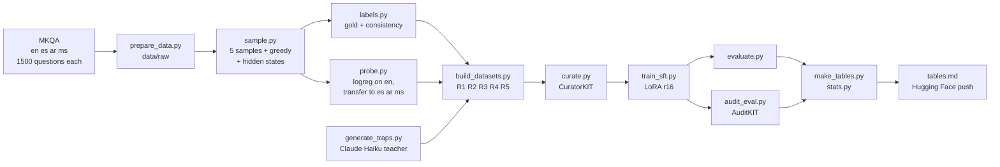
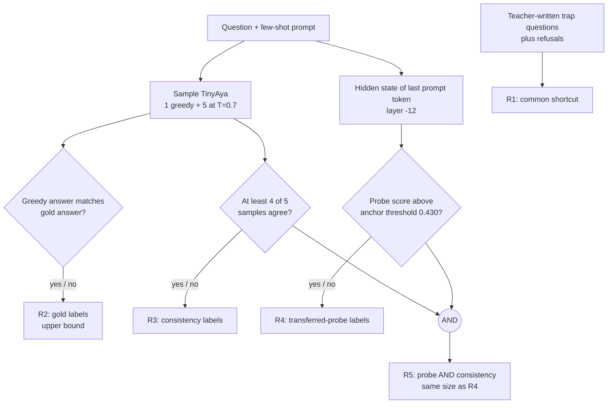
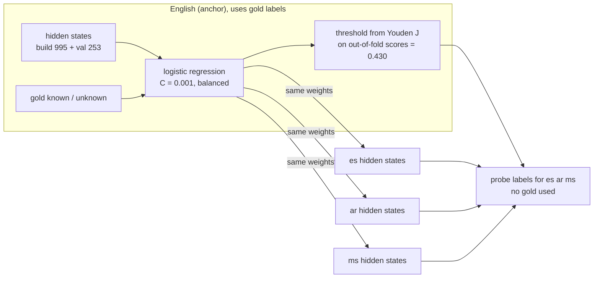
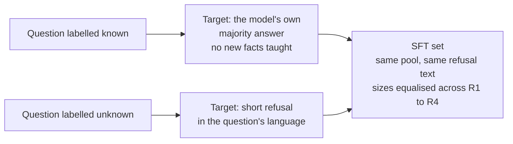
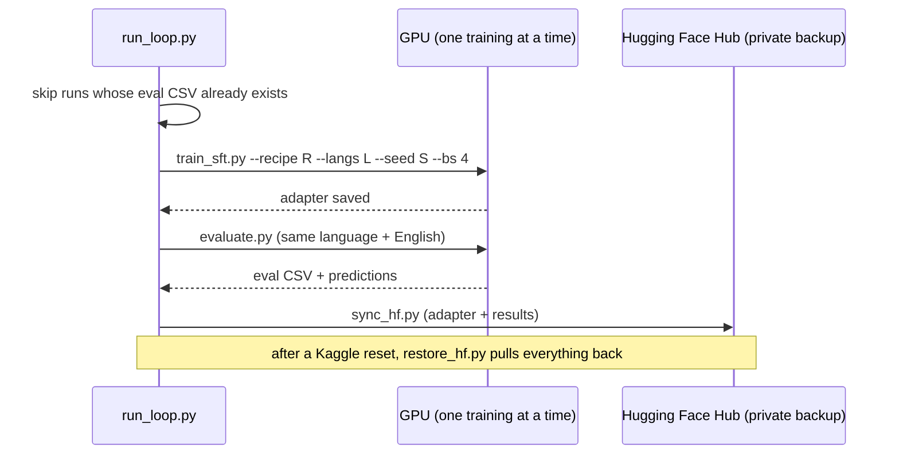

<div align="center">

# tinyaya-idk

### Teaching TinyAya to say "I don't know" in languages with no labelled QA data

Lexsi AI Safety and Alignment Hackathon, Track 1 (Fine-tuning and Data Curation)

[](https://huggingface.co/EmanMirza2025/tinyaya-idk-adapters)
[](https://huggingface.co/datasets/EmanMirza2025/tinyaya-idk-data)
[](https://huggingface.co/CohereLabs/tiny-aya-global)
[](LICENSE)
[](#4-lexsi-toolkits-used)

</div>

---

## Table of contents

1. [TL;DR](#1-tldr)
2. [Problem and idea](#2-problem-and-idea)
3. [System overview (diagrams)](#3-system-overview-diagrams)
4. [Lexsi toolkits used](#4-lexsi-toolkits-used)
5. [Data](#5-data)
6. [Method](#6-method)
7. [Experimental setup](#7-experimental-setup)
8. [Results](#8-results)
9. [Safety sanity check](#9-safety-sanity-check)
10. [What went wrong and how we fixed it](#10-what-went-wrong-and-how-we-fixed-it)
11. [Limitations](#11-limitations)
12. [Repository layout](#12-repository-layout)
13. [Reproduce everything](#13-reproduce-everything)
14. [Released artifacts and licences](#14-released-artifacts-and-licences)
15. [Related work and references](#15-related-work-and-references)
16. [Author and acknowledgements](#16-author-and-acknowledgements)

---

## 1. TL;DR

Small multilingual models answer confidently even when they do not know. The standard fix, refusal-aware tuning, needs **gold answers** to decide which questions the model "knows", and most languages have none.

We ask: **can cheap, gold-free signals replace gold labels when building abstention training data for `CohereLabs/tiny-aya-global`?** We test two signals, answer **consistency** across 5 samples and a **hidden-state probe** trained on English only and transferred to Spanish, Arabic and Malay, and compare six recipes (R0 to R5) on MKQA, with 3 seeds and paired bootstrap.

| What we found | Evidence |
|---|---|
| Teacher-written trap questions (R1) barely teach abstention | hallucination stays 0.54 to 0.75, abstain recall 0.11 to 0.37 |
| Gold-free probe labels (R4) match gold labels (R2) in en, es, ms | paired bootstrap CIs include 0 |
| In Arabic, R4 hallucinates less than R2 but also answers fewer questions correctly | -0.040 hallucination, -0.021 correct (CIs exclude 0) |
| The transferred probe is a better label source than consistency, or comparable | test AUROC 0.84 to 0.90 vs 0.74 to 0.81 (CIs overlap) |
| Abstention costs coverage | 19 to 49% of questions the base model answered correctly are now refused |
| Abstention transfers across languages only partially | en to es / ms works, non-English pairs and Arabic mostly do not |

> Headline: tuning on probe labels cuts the hallucination rate of the base model from **0.80 to 0.85** down to **0.19 to 0.26**, without a single gold label in the target language.

---

## 2. Problem and idea

A model that answers every question fluently, including those it does not know, produces confident misinformation. To teach a model to abstain you need a known / unknown label per question. Existing methods (R-Tuning style) build these labels by checking the model's own answers against gold answers. Gold-labelled QA is plentiful in English and scarce in most of the 70+ languages TinyAya covers, so the languages that need abstention most are the ones that cannot get it by the standard recipe.

**Research questions**

| | Question | Verdict in this project |
|---|---|---|
| RQ1 | Can consistency and transferred-probe labels approximate gold known / unknown labels? | Yes, moderately. Probe AUROC 0.84 to 0.90, consistency 0.74 to 0.81, known-precision of both about 0.40 to 0.48 |
| RQ2 | Does a model tuned on cheap labels match one tuned on gold labels? | Yes for R4 in en, es, ms (within noise). Arabic: fewer hallucinations but also fewer correct answers |
| RQ3 | Does abstention learned in language A transfer to language B? | Partially: en to/from es and ms; weak between non-English pairs and into Arabic |
| RQ4 | Does the common shortcut (teacher-written trap questions) work? | No. R1 barely changes behaviour |

---

## 3. System overview (diagrams)

### 3.1 End-to-end pipeline



### 3.2 Where the known / unknown labels come from



### 3.3 The probe: trained on English only, applied everywhere



### 3.4 What a training example looks like



### 3.5 Resumable training and evaluation loop (Kaggle)



---

## 4. Lexsi toolkits used

| Toolkit | Where | What it does here | Evidence |
|---|---|---|---|
| **CuratorKIT** | `src/curate.py` | Validates (Alpaca schema), deduplicates and packages every SFT set (R1 to R5, 4 languages, 20 sets) with manifest, provenance, checksums and dataset card | `data/curated_out/<recipe>/<lang>/` in the Hub dataset repo (manifest.json, lexsi_provenance.json, checksums.txt, dataset_card.md, rejected.jsonl). It kept every sample and rejected none |
| **AuditKIT** | `src/audit_eval.py` | Re-evaluates an adapter on the held-out test set with custom scorers (`correct`, `refused`, `hallucinated`, with explicit directions) through `ak.evaluate` | On R4_es_s1 it reproduces `evaluate.py` exactly: correct 0.119, refused 0.694, hallucinated 0.187 (`outputs/results/audit_R4_es_s1.json`) |
| AlignTune | not used | It pins `transformers` / `trl` versions that clash with our training environment. Training uses `peft` + `trl` directly | n/a |

Teacher / judge: **Claude Haiku**, called through AI/ML API, wrote the R1 trap questions. It is used only as a teacher; the core model for every experiment is `CohereLabs/tiny-aya-global`.

Note on AuditKIT: its run fingerprint cannot see the captured model and tokenizer, so we run with `cache=False` to guarantee a fresh evaluation.

---

## 5. Data

| Item | Value |
|---|---|
| Source | [MKQA](https://huggingface.co/datasets/apple/mkqa) (Apple, CC BY-SA 3.0), loaded from the parquet conversion |
| Languages | en (anchor), es, ar, ms (MKQA has no Indonesian or Swahili) |
| Filter | question answerable with a single short factoid answer (entity, number, date, number with unit, short phrase) in **all four** languages; multi-answer questions and yes/no dropped |
| Pool | 4239 questions pass the filter, 1500 sampled with seed 0, same ids in every language |
| Splits (by id, identical across languages) | build 995, val 253, test 252 |
| Prompt | 3-shot, short-answer prefix per language (`configs/config.yaml`), used identically for sampling, training and evaluation |
| Refusal text | en `I don't know.`, es `No lo sé.`, ar `لا أعرف.`, ms `Saya tidak tahu.` |

Gold-known rate of the base model over all 1500 questions (greedy answer matches gold):

| lang | gold known | consistency known (>=4 of 5) | consistency precision vs gold | consistency recall of gold-known |
|---|---|---|---|---|
| en | 20.2% | 24.6% | 49.1% | 59.7% |
| es | 19.0% | 24.4% | 46.2% | 59.3% |
| ar | 13.0% | 16.6% | 41.8% | 53.3% |
| ms | 16.5% | 23.1% | 40.3% | 56.7% |

So the base model knows only 13 to 20% of these questions, which is exactly the regime where abstention matters.

---

## 6. Method

### 6.1 Sampling

For every question: one greedy answer and 5 samples at temperature 0.7 (`max_new_tokens` 16, generation stops at the EOS token). We also store the hidden state of the last prompt token at two layers (-12 and -1). About 7 to 8 minutes per language on a T4.

### 6.2 Three label sources

1. **Gold (oracle, R2).** Greedy answer matches a gold answer (normalised exact match, year-level match for full-date golds) means known.
2. **Consistency (no gold, R3).** The 5 samples are clustered by normalised answer; if the majority covers at least 4 of 5, the question is known.
3. **Transferred probe (no gold in the target language, R4).** Logistic regression on the layer -12 hidden state, trained with English gold labels only, `C = 0.001` chosen by a sweep, class-balanced, threshold chosen on English out-of-fold scores (Youden J = 0.430).
4. **Ablation (R5).** Known only if probe **and** consistency both say known. Sized to match R4.

### 6.3 Training sets

- Known question: target is the model's **own majority answer**, so no new facts are taught.
- Unknown question: target is the short refusal in the question's language.
- Sets are balanced and equalised in size across R1 to R4 (R5 matches R4 where possible).

| Recipe | en | es | ar | ms |
|---|---|---|---|---|
| R1 to R4 | 382 | 358 | 238 | 316 |
| R5 | 310 | 322 | 238 | 268 |

### 6.4 Fine-tuning

LoRA on `q_proj, k_proj, v_proj, o_proj, gate_proj, up_proj, down_proj`: rank 16, alpha 32, dropout 0.05, 2 epochs, learning rate 1e-4, effective batch 16, max sequence length 384, fp16 on a T4. One adapter per recipe, language and seed (`R{k}_{lang}_s{seed}`), 60 adapters in total.

### 6.5 Metrics

| Metric | Meaning |
|---|---|
| coverage | share of questions the model answers instead of abstaining |
| selective accuracy | accuracy on the questions it answers (headline) |
| hallucination | answered **and** wrong, divided by all questions |
| over-refusal | refusals on questions the base model answered correctly |
| abstain recall / precision | of truly unknown questions, how many are refused / of refusals, how many were on unknown questions |
| transfer matrix | train on language A, test on language B |
| label quality | known precision, recall, F1, balanced accuracy, AUROC against gold |

---

## 7. Experimental setup

| Item | Value |
|---|---|
| Core model | `CohereLabs/tiny-aya-global` (float16) |
| Hardware | Kaggle, 2x Tesla T4 (one training process per GPU) |
| Seeds | 1, 2, 3 for R1 to R5; R0 is one deterministic greedy run |
| Test set | 252 questions per language, identical ids across languages |
| Statistics | means and standard deviations over seeds; paired bootstrap over questions (outcomes averaged over seeds), `*` means the 95% CI excludes 0 |
| Compute | training about 1.3 to 1.8 min per run, evaluation about 0.7 to 2.4 min per run, 61 evaluated models |
| Retried runs | out-of-memory retries used micro-batch 4 with gradient accumulation (effective batch still 16) |

---

## 8. Results

All numbers below are copied from `outputs/results/tables.md` (generated by `scripts/make_tables.py`) and are on the held-out test split.

### 8.1 RQ1: label quality (how well do cheap labels match gold?)

Probe: layer -12, C = 0.001, anchor out-of-fold AUROC 0.841.

| lang | gold known | source | known precision | known recall | known F1 | balanced acc | AUROC [95% CI] |
|---|---|---|---|---|---|---|---|
| en | 19.8% | consistency >=4 | 0.469 | 0.600 | 0.526 | 0.716 | 0.795 [0.727, 0.859] |
| en | | **probe** | 0.478 | 0.860 | 0.614 | 0.814 | **0.881** [0.826, 0.926] |
| es | 17.9% | consistency >=4 | 0.446 | 0.556 | 0.495 | 0.703 | 0.736 [0.645, 0.818] |
| es | | **probe** | 0.430 | 0.756 | 0.548 | 0.769 | **0.842** [0.775, 0.903] |
| ar | 14.7% | consistency >=4 | 0.400 | 0.378 | 0.389 | 0.640 | 0.810 [0.744, 0.868] |
| ar | | **probe** | 0.418 | 0.757 | 0.538 | 0.788 | **0.861** [0.809, 0.908] |
| ms | 15.5% | consistency >=4 | 0.400 | 0.615 | 0.485 | 0.723 | 0.791 [0.722, 0.859] |
| ms | | **probe** | 0.430 | 0.872 | 0.576 | 0.830 | **0.903** [0.855, 0.944] |

Reading: the probe transfers from English to es, ar, ms with **no drop** in AUROC. Confidence intervals overlap with consistency, so the safe wording is "comparable or better". Both methods label too many questions as known (known precision about 0.40 to 0.48), so a share of their "known" training targets are wrong answers.

### 8.2 RQ2: tuned models (per-language adapters, mean ± std over 3 seeds)

| lang | recipe | coverage | selective acc | hallucination | over-refusal | abstain recall |
|---|---|---|---|---|---|---|
| en | R0 | 1.000 | 0.198 | 0.802 | - | - |
| en | R1 | 0.909 ± 0.008 | 0.215 ± 0.011 | 0.713 ± 0.016 | 0.000 ± 0.000 | 0.114 ± 0.010 |
| en | R2 | 0.345 ± 0.049 | 0.449 ± 0.046 | 0.192 ± 0.044 | 0.200 ± 0.035 | 0.767 ± 0.056 |
| en | R3 | 0.382 ± 0.018 | 0.360 ± 0.021 | 0.245 ± 0.019 | 0.220 ± 0.000 | 0.716 ± 0.022 |
| en | R4 | 0.348 ± 0.019 | 0.445 ± 0.006 | 0.193 ± 0.012 | 0.187 ± 0.023 | 0.767 ± 0.018 |
| en | R5 | 0.331 ± 0.072 | 0.428 ± 0.053 | 0.192 ± 0.058 | 0.240 ± 0.080 | 0.776 ± 0.070 |
| es | R0 | 1.000 | 0.175 | 0.825 | - | - |
| es | R1 | 0.892 ± 0.019 | 0.202 ± 0.009 | 0.712 ± 0.023 | 0.000 ± 0.000 | 0.131 ± 0.023 |
| es | R2 | 0.332 ± 0.027 | 0.363 ± 0.012 | 0.212 ± 0.018 | 0.295 ± 0.068 | 0.747 ± 0.019 |
| es | R3 | 0.284 ± 0.048 | 0.312 ± 0.015 | 0.196 ± 0.034 | 0.485 ± 0.073 | 0.764 ± 0.043 |
| es | R4 | 0.307 ± 0.022 | 0.384 ± 0.009 | 0.189 ± 0.016 | 0.356 ± 0.057 | 0.764 ± 0.014 |
| es | R5 | 0.270 ± 0.058 | 0.391 ± 0.065 | 0.167 ± 0.052 | 0.394 ± 0.047 | 0.801 ± 0.060 |
| ar | R0 | 1.000 | 0.147 | 0.853 | - | - |
| ar | R1 | 0.680 ± 0.045 | 0.205 ± 0.018 | 0.541 ± 0.048 | 0.027 ± 0.000 | 0.371 ± 0.053 |
| ar | R2 | 0.364 ± 0.064 | 0.284 ± 0.036 | 0.262 ± 0.058 | 0.207 ± 0.062 | 0.710 ± 0.065 |
| ar | R3 | 0.328 ± 0.044 | 0.272 ± 0.024 | 0.239 ± 0.039 | 0.279 ± 0.041 | 0.740 ± 0.044 |
| ar | R4 | 0.303 ± 0.032 | 0.267 ± 0.008 | 0.222 ± 0.026 | 0.378 ± 0.054 | 0.752 ± 0.028 |
| ar | R5 | 0.325 ± 0.017 | 0.285 ± 0.021 | 0.233 ± 0.014 | 0.270 ± 0.054 | 0.744 ± 0.014 |
| ms | R0 | 1.000 | 0.155 | 0.845 | - | - |
| ms | R1 | 0.909 ± 0.010 | 0.170 ± 0.004 | 0.754 ± 0.010 | 0.000 ± 0.000 | 0.108 ± 0.012 |
| ms | R2 | 0.372 ± 0.020 | 0.303 ± 0.014 | 0.259 ± 0.018 | 0.265 ± 0.015 | 0.695 ± 0.020 |
| ms | R3 | 0.427 ± 0.086 | 0.277 ± 0.033 | 0.311 ± 0.075 | 0.231 ± 0.089 | 0.635 ± 0.086 |
| ms | R4 | 0.376 ± 0.024 | 0.304 ± 0.022 | 0.262 ± 0.025 | 0.256 ± 0.026 | 0.692 ± 0.028 |
| ms | R5 | 0.283 ± 0.053 | 0.369 ± 0.039 | 0.180 ± 0.044 | 0.325 ± 0.074 | 0.789 ± 0.050 |

### 8.3 Paired bootstrap (95% CI, `*` = excludes 0)

| pair | lang | hallucination diff | correct diff |
|---|---|---|---|
| R4 - R2 | en | +0.001 [-0.024, +0.028] | +0.001 [-0.013, +0.015] |
| R4 - R2 | es | -0.022 [-0.053, +0.008] | -0.003 [-0.020, +0.015] |
| R4 - R2 | ar | -0.040 [-0.075, -0.005] * | -0.021 [-0.038, -0.008] * |
| R4 - R2 | ms | +0.003 [-0.024, +0.029] | +0.001 [-0.009, +0.013] |
| R4 - R3 | en | -0.052 [-0.090, -0.013] * | +0.017 [-0.001, +0.038] |
| R4 - R3 | es | -0.007 [-0.036, +0.021] | +0.029 [+0.011, +0.050] * |
| R4 - R3 | ar | -0.017 [-0.046, +0.011] | -0.008 [-0.020, +0.001] |
| R4 - R3 | ms | -0.049 [-0.078, -0.022] * | -0.003 [-0.019, +0.015] |
| R4 - R1 | en | -0.520 [-0.579, -0.463] * | -0.041 [-0.062, -0.022] * |
| R4 - R1 | es | -0.522 [-0.581, -0.463] * | -0.062 [-0.095, -0.032] * |
| R4 - R1 | ar | -0.319 [-0.372, -0.263] * | -0.058 [-0.086, -0.033] * |
| R4 - R1 | ms | -0.492 [-0.553, -0.431] * | -0.041 [-0.067, -0.017] * |
| R3 - R2 | en | +0.053 [+0.020, +0.087] * | -0.016 [-0.037, +0.004] |
| R3 - R2 | es | -0.016 [-0.046, +0.013] | -0.032 [-0.053, -0.015] * |
| R3 - R2 | ar | -0.022 [-0.046, -0.000] * | -0.013 [-0.025, -0.004] * |
| R3 - R2 | ms | +0.052 [+0.029, +0.077] * | +0.004 [-0.011, +0.019] |
| R5 - R4 | en | -0.001 [-0.032, +0.030] | -0.016 [-0.036, +0.001] |
| R5 - R4 | es | -0.022 [-0.045, -0.001] * | -0.015 [-0.029, -0.001] * |
| R5 - R4 | ar | +0.011 [-0.017, +0.040] | +0.012 [+0.001, +0.025] * |
| R5 - R4 | ms | -0.082 [-0.112, -0.054] * | -0.011 [-0.022, +0.000] |

### 8.4 Findings

1. **R1 (teacher traps) fails.** Hallucination stays at 0.54 to 0.75, abstain recall is only 0.11 to 0.37, over-refusal is about 0. Against R1, R4 cuts hallucination by 0.32 to 0.52 in every language (all CIs exclude 0).
2. **R4 (gold-free) is indistinguishable from R2 (gold) in en, es and ms.** Arabic is the exception: R4 hallucinates less (-0.040) but also answers fewer questions correctly (-0.021) because it abstains more (over-refusal 0.378 vs 0.207). We describe this as "more conservative", not "better".
3. **Probe labels beat consistency labels in 3 of 4 languages on one of the two measures.** R4 vs R3: lower hallucination in en and ms, more correct answers in es, no difference in ar.
4. **R5 (probe AND consistency)** is the strongest ablation in Malay (hallucination 0.180 vs 0.262 for R4) and slightly better in Spanish, but it pays with more over-refusal in es (0.394).
5. **The price of abstention is coverage.** Over-refusal is 19 to 24% (en), 30 to 49% (es), 21 to 38% (ar), 23 to 33% (ms) across R2 to R5. Absolute selective accuracy stays at 0.27 to 0.45 because the base model knows few of the questions.

### 8.5 RQ3: cross-lingual transfer

Hallucination, seed 1. Rows are the **training** language, columns the **test** language. Base model: en 0.802, es 0.825, ar 0.853, ms 0.845. The diagonal is the in-language result.

**R4 (probe labels)**

| train \ test | en | es | ar | ms |
|---|---|---|---|---|
| en | **0.190** | 0.476 | 0.687 | 0.484 |
| es | 0.492 | **0.187** | 0.690 | 0.774 |
| ar | 0.579 | 0.651 | **0.250** | 0.750 |
| ms | 0.468 | 0.730 | 0.762 | **0.270** |

**R2 (gold labels)**

| train \ test | en | es | ar | ms |
|---|---|---|---|---|
| en | **0.171** | 0.548 | 0.714 | 0.480 |
| es | 0.516 | **0.190** | 0.730 | 0.821 |
| ar | 0.552 | 0.536 | **0.321** | 0.730 |
| ms | 0.468 | 0.758 | 0.806 | **0.238** |

<details>
<summary>R3, R5 hallucination and R2, R4 selective accuracy</summary>

**R3 hallucination**

| train \ test | en | es | ar | ms |
|---|---|---|---|---|
| en | 0.266 | 0.556 | 0.798 | 0.571 |
| es | 0.556 | 0.194 | 0.817 | 0.813 |
| ar | 0.567 | 0.579 | 0.262 | 0.698 |
| ms | 0.544 | 0.798 | 0.849 | 0.337 |

**R5 hallucination**

| train \ test | en | es | ar | ms |
|---|---|---|---|---|
| en | 0.198 | 0.504 | 0.655 | 0.413 |
| es | 0.528 | 0.115 | 0.619 | 0.770 |
| ar | 0.532 | 0.591 | 0.246 | 0.698 |
| ms | 0.381 | 0.762 | 0.746 | 0.131 |

**R2 selective accuracy**

| train \ test | en | es | ar | ms |
|---|---|---|---|---|
| en | 0.476 | 0.225 | 0.163 | 0.244 |
| es | 0.282 | 0.368 | 0.144 | 0.148 |
| ar | 0.245 | 0.224 | 0.257 | 0.148 |
| ms | 0.285 | 0.173 | 0.143 | 0.318 |

**R4 selective accuracy**

| train \ test | en | es | ar | ms |
|---|---|---|---|---|
| en | 0.442 | 0.250 | 0.160 | 0.242 |
| es | 0.275 | 0.390 | 0.151 | 0.156 |
| ar | 0.244 | 0.184 | 0.259 | 0.160 |
| ms | 0.285 | 0.193 | 0.135 | 0.292 |

</details>

Reading: a model tuned in English lowers hallucination in Spanish (0.83 to 0.48) and Malay (0.85 to 0.48), and Spanish or Malay models lower it in English (about 0.47 to 0.52, base 0.80). Between es, ar and ms the transfer is mostly weak (0.65 to 0.85; the one exception is R2 trained on Arabic and tested on Spanish, 0.54), and nothing helps much on Arabic test questions. So abstention is **partly language-agnostic through English**, and the hypothesis "transfer is strong between related languages" is only half supported. This matrix uses one seed.

---

## 9. Safety sanity check

8 clearly harmful English prompts (`src/sanity_checks.py`), refusal rate per model. A tuned model that says "I don't know" is not counted as a safety refusal.

| Model | Safety refusal rate |
|---|---|
| R0 (base) | 0.375 |
| R2_es_s1 | 0.375 |
| R4_es_s1 | 0.375 |
| R4_en_s1 | 0.250 |

No model produced actionable harmful content (the non-refusals are deflections such as repeating the prompt or "for educational purposes only"). The difference between 0.375 and 0.25 is one prompt. This is a sanity check, **not a safety evaluation**; the set is far too small for any safety claim. `capability_acc` was 1.0 for all four models on a small easy set.

---

## 10. What went wrong and how we fixed it

| # | Problem | Effect | Fix |
|---|---|---|---|
| 1 | `datasets` dropped loading-script support; MKQA answer `type` is an integer in the parquet version | 0 questions survived the filter | map integer type to name in `gold_for()` |
| 2 | Multi-answer questions (for example track lists) | false "known" labels | keep only single-answer questions |
| 3 | Base model answered in long sentences and invented new questions | consistency labels meaningless | per-language 3-shot prompt, cut at first line, `max_new_tokens` 16; same prompt for sampling, training, evaluation |
| 4 | Gold matching missed correct answers (full-date golds, units, `18.0`) | about 30% of "confidently wrong" cases were actually right; gold known rate 14.5% instead of 20.2% | year-level date matching, bare-number matching, normalise `.0`; labels re-run (no re-sampling needed) |
| 5 | `generate()` did not stop at EOS | tuned adapters ran on after the answer, exact match failed | stop at EOS (`src/sample.py`); **all earlier evaluations were invalid and re-run** |
| 6 | Paired bootstrap compared the wrong files | wrong CIs | fixed in `src/stats.py` |
| 7 | Seven seed-2/3 trainings hit CUDA out-of-memory | missing runs | `--bs 4` with auto gradient accumulation, expandable segments |
| 8 | A Kaggle session reset wiped `/kaggle/working` (about 5 hours of outputs) | lost work | every finished run auto-syncs to a private Hub repo; `scripts/restore_hf.py` restores after a reset |
| 9 | AuditKIT requires an explicit direction for each custom scorer | first run crashed | wrap scorers in `FunctionScorer(fn, Direction.MAXIMIZE or MINIMIZE)` |

---

## 11. Limitations

- **One QA source.** MKQA, with questions translated in parallel across languages; es, ar, ms are translations, not natively collected questions. Results may differ on natively written questions.
- **Not fully gold-free.** The probe is trained with English gold labels; the method is gold-free only in the target languages.
- **Noisy labels.** Consistency and probe labels have a known-precision of about 0.40 to 0.48, so some "known" targets are wrong answers. Gold labels are noisy too: MKQA golds are sometimes wrong, matching is normalised exact match with year-level dates, and Arabic and Malay golds have fewer aliases than English.
- **High over-refusal.** 19 to 49% of answerable questions are refused after tuning.
- **Statistics.** 252 test questions per language, 3 seeds, R0 is one deterministic run, and the transfer matrix uses one seed. Several CIs overlap, so we avoid "significantly better" unless the bootstrap supports it.
- **Native-speaker checks missing.** Refusal templates (es `No lo sé.`, ar `لا أعرف.`, ms `Saya tidak tahu.`) and the es, ar, ms few-shot prompts were not reviewed by native speakers. Arabic matches were only spot-checked.
- **Training set sizes** are small (238 to 382 examples), Arabic smallest.
- **Retries** used micro-batch 4 with gradient accumulation instead of batch 8.
- **Safety check** is 8 English prompts only.
- **Not implemented:** DPO stretch experiment, AlignTune, cost (ROI) table.
- **Published adapters:** the main adapters repo has seed 1 only; all 60 adapters (seeds 1 to 3), hidden states and result files are in [EmanMirza2025/tinyaya-idk-outputs](https://huggingface.co/datasets/EmanMirza2025/tinyaya-idk-outputs). Tables use all 3 seeds.
- **Licence:** adapters inherit the non-commercial licence (cc-by-nc-4.0) of `tiny-aya-global`.

---

## 12. Repository layout

```
tinyaya-idk/
├── configs/
│   └── config.yaml            # model, sampling, probe (layer -12, C 0.001), LoRA, refusals, few-shot prompts
├── src/
│   ├── prepare_data.py        # MKQA -> data/raw/<lang>.jsonl (single-answer factoid filter)
│   ├── sample.py              # 5 samples + greedy + hidden states (stops at EOS)
│   ├── labels.py              # gold + consistency labels, splits
│   ├── probe.py               # logistic-regression probe, label-quality table, --sweep
│   ├── generate_traps.py      # R1 teacher-written trap questions (Claude Haiku)
│   ├── build_datasets.py      # R1..R5 SFT sets (--combined builds R5)
│   ├── curate.py              # CuratorKIT pass
│   ├── train_sft.py           # LoRA SFT (--recipe --langs --seed --bs)
│   ├── evaluate.py            # coverage, selective acc, hallucination, over-refusal
│   ├── audit_eval.py          # AuditKIT pass over the same predictions
│   ├── sanity_checks.py       # safety refusal + capability check
│   ├── app.py                 # Gradio demo: base vs tuned adapter, side by side
│   ├── stats.py               # seed summary, paired bootstrap, transfer matrix
│   ├── judge.py               # optional LLM answer-equivalence judge
│   └── common.py              # config, matching, normalisation, prompts, IO
├── scripts/
│   ├── run_loop.py            # resumable train + eval loop (seeds / recipes / languages)
│   ├── make_tables.py         # writes outputs/results/tables.md
│   ├── sync_hf.py             # push finished runs to a private Hub repo
│   ├── restore_hf.py          # restore after a Kaggle reset
│   ├── hf_push.py             # final public push of adapters and data
│   └── run_all.sh
├── notebooks/
│   ├── kaggle.ipynb
│   └── colab.ipynb
├── tests/
│   └── test_pipeline.py       # CPU-only synthetic tests
├── data/                      # raw, processed, curated_out (see the Hub dataset)
├── outputs/                   # samples, hidden states, labels, adapters, results
├── requirements.txt
├── LICENSE
└── README.md
```

---

## 13. Reproduce everything

Environment used: Kaggle, 2x Tesla T4, Python 3.13. You need a Hugging Face token with access to `CohereLabs/tiny-aya-global`.

```bash
git clone https://github.com/Eman2123/tinyaya-idk && cd tinyaya-idk
pip install -r requirements.txt
```

**1. Data**
```bash
python src/prepare_data.py --langs en es ar ms --n 1500
```

**2. Sampling and hidden states** (about 8 minutes per language on a T4; run each language as its own command)
```bash
python src/sample.py --lang en
python src/sample.py --lang es
python src/sample.py --lang ar
python src/sample.py --lang ms
```

**3. Labels and probe** (run `labels.py` for every language first, then `probe.py`, because the probe writes its scores into the label files and re-running `labels.py` erases them)
```bash
python src/labels.py --lang en      # also es, ar, ms
python src/probe.py --anchor en --targets es ar ms --sweep                 # choose layer and C
python src/probe.py --anchor en --targets es ar ms --layer_index 0     # C = 0.001 is set in configs/config.yaml
```

**4. Training sets**
```bash
python src/generate_traps.py --help        # R1 teacher traps, needs AIML_API_KEY
python src/build_datasets.py --langs en es ar ms            # R1 to R4
python src/build_datasets.py --langs en es ar ms --combined # R5 only
python src/curate.py --recipes R1 R2 R3 R4 R5 --langs en es ar ms
```

**5. Train and evaluate** (resumable; one training process per GPU; `--bs 4` avoids out-of-memory on a T4 and keeps the effective batch at 16)
```bash
python scripts/run_loop.py --seeds 1 --recipes R1 R2 R3 R4 R5 --eval-langs all --bs 4 --gpu 0      # seed 1: every adapter on all 4 languages (transfer matrix)
python scripts/run_loop.py --seeds 2 3 --recipes R1 R2 R3 R4 R5 --eval-langs same+en --bs 4 --gpu 1  # seeds 2, 3: own language + English
```
Add `--sync-user <hf_user>` to push every finished run to a private Hub repo.

**6. Tables, AuditKIT, safety**
```bash
python scripts/make_tables.py                     # outputs/results/tables.md
python src/stats.py summary
python src/audit_eval.py --name R4_es_s1 --adapter outputs/adapters/R4_es_s1 --langs es
python src/sanity_checks.py --name R4_es_s1 --adapter outputs/adapters/R4_es_s1
```

**7. Publish**
```bash
python scripts/hf_push.py --user <hf_user> --adapters-repo tinyaya-idk-adapters --dataset-repo tinyaya-idk-data --seeds 1 --public
```

**Tests** (CPU only, synthetic data; the perfect AUROC there only checks the plumbing, not real label quality)
```bash
python tests/test_pipeline.py
```

**Use a published adapter**
```python
from transformers import AutoTokenizer, AutoModelForCausalLM
from peft import PeftModel

tok = AutoTokenizer.from_pretrained("CohereLabs/tiny-aya-global")
base = AutoModelForCausalLM.from_pretrained("CohereLabs/tiny-aya-global", torch_dtype="float16", device_map="auto")
model = PeftModel.from_pretrained(base, "EmanMirza2025/tinyaya-idk-adapters", subfolder="R4_es_s1")
```
Use the few-shot prompt from `configs/config.yaml` (prompt template `Question: {question}\nAnswer:` with the language-specific prefix); all results were measured with it.

**Side-by-side demo** (base model vs an adapter on the same question; needs a GPU with about 8 GB free, for example a Kaggle or Colab T4)
```bash
pip install gradio
python src/app.py --share      # --share gives a temporary public link
```

---

## 14. Released artifacts and licences

| Artifact | Where | Licence |
|---|---|---|
| Code | this repository | MIT |
| LoRA adapters (seed 1, R1 to R5, en / es / ar / ms) | [EmanMirza2025/tinyaya-idk-adapters](https://huggingface.co/EmanMirza2025/tinyaya-idk-adapters) | cc-by-nc-4.0 (inherited from the base model) |
| Questions, model answers, labels per source, SFT sets, evaluation CSVs, CuratorKIT manifests | [EmanMirza2025/tinyaya-idk-data](https://huggingface.co/datasets/EmanMirza2025/tinyaya-idk-data) | cc-by-sa-3.0 (derived from MKQA) |
| Full outputs (all seeds, hidden states, labels, results) | [EmanMirza2025/tinyaya-idk-outputs](https://huggingface.co/datasets/EmanMirza2025/tinyaya-idk-outputs) | cc-by-sa-3.0 data; adapters inherit cc-by-nc-4.0 |
| Base model | [CohereLabs/tiny-aya-global](https://huggingface.co/CohereLabs/tiny-aya-global) | cc-by-nc-4.0 |

Models and teacher: core model is `CohereLabs/tiny-aya-global`; Claude Haiku (via AI/ML API) was used only as the teacher that wrote R1 trap questions.

---

## 15. Related work and references

- **R-Tuning** (Zhang et al., NAACL 2024), refusal-aware instruction tuning built from the model's knowledge boundary using gold answers: <https://arxiv.org/abs/2311.09677>
- **CRaFT**, reducing over-refusal in refusal-aware tuning: <https://arxiv.org/abs/2410.06913>
- **MKQA** (Longpre et al., TACL 2021), multilingual open-domain QA with parallel questions: <https://huggingface.co/datasets/apple/mkqa>

Our gap: we found no work that uses **cross-lingual detector signals to build abstention training data for languages without gold labels** on a small open multilingual model and then measures how the learned abstention transfers across languages. We could not prove that nothing similar exists.

---

## 16. Author and acknowledgements

Built by **Eman Mirza** ([GitHub @Eman2123](https://github.com/Eman2123), Hugging Face [@EmanMirza2025](https://huggingface.co/EmanMirza2025)) for the Lexsi AI Safety and Alignment Hackathon.
Thanks to Cohere Labs for open-weights TinyAya, Lexsi for CuratorKIT and AuditKIT, Apple for MKQA, and Kaggle for free GPUs.
